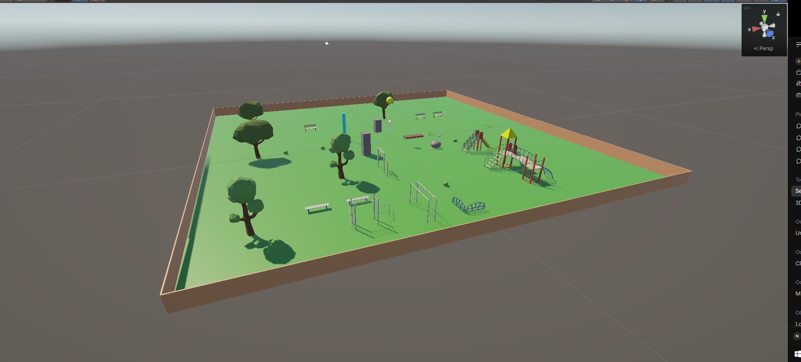
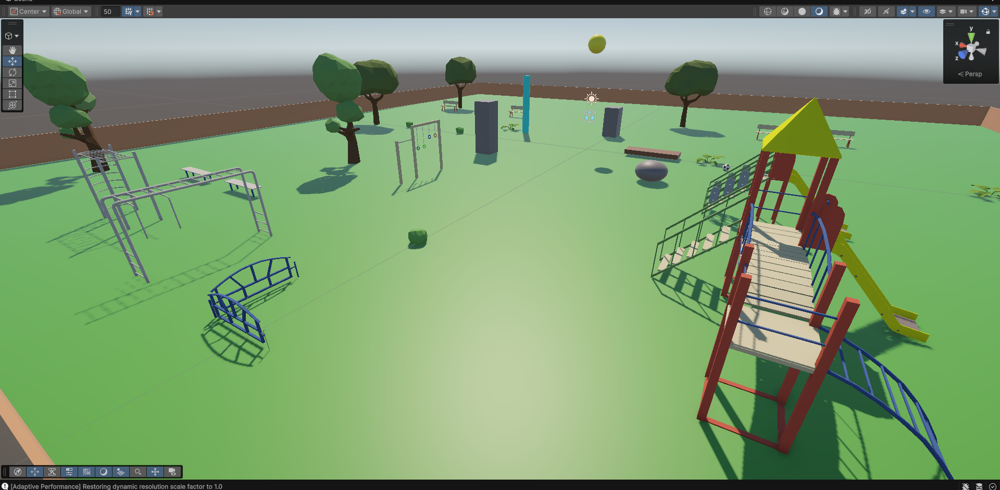
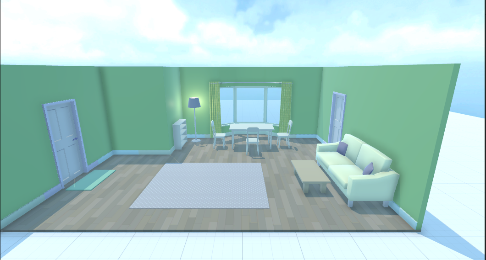
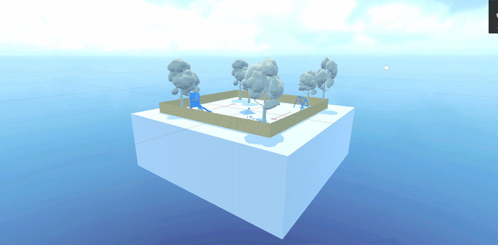

# Unity Coursework (Nawaf Tahir)

- ParkPhysicsEnvironment: 3D park with Rigidbody, Colliders and a bouncing ball
- UnityEssentials: Unity Learn Essentials modules
- Media: demo video and screenshots

Unity version: (6000.3.23f1)

[▶️Park Environment Video](Media/ParkEnvironment.mp4)

## Unity Essentials

